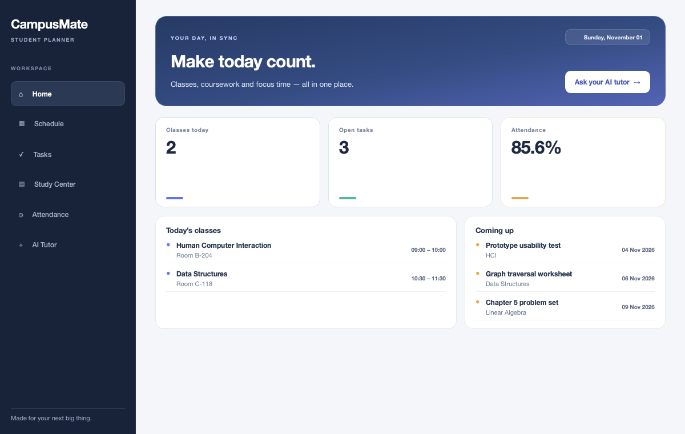

# CampusMate

CampusMate is a desktop organizer for students, with a dashboard, class schedule, task list, attendance tracker, study notes, a Pomodoro timer, and an optional AI Tutor.



## Try the phone-friendly web preview

Open the [CampusMate phone app](https://meaditya1012-sketch.github.io/CampusMate-Desktop/) in Safari or Chrome. On iPhone, use **Share → Add to Home Screen**; on Android, open Chrome's menu and choose **Install app** or **Add to Home screen**. It then opens from a home-screen icon. The app stores data in that browser on that device; it does not sync with the Mac app or between devices. The AI Tutor remains available in the desktop app when Ollama is running locally.

## Download

Download the latest macOS app from the [public CampusMate-Desktop release](https://github.com/meaditya1012-sketch/CampusMate-Desktop/releases/latest). The current build is for Apple silicon. The app is not Developer ID signed or notarized, so macOS may ask you to Control-click it and choose **Open** the first time.

## Run from source

Requires Python and `pip`.

```bash
python3 -m venv .venv
source .venv/bin/activate
python -m pip install -r requirements.txt
python main.py
```

CampusMate creates its SQLite tables on first launch. When run from source, its database lives beside `main.py`.

## AI Tutor setup

The AI Tutor connects to Ollama on the same computer and uses `llama3.2:3b`. The rest of CampusMate works without Ollama.

1. Install Ollama from [ollama.com](https://ollama.com/).
2. Download the model with `ollama pull llama3.2:3b`.
3. Start Ollama, then open CampusMate's AI Tutor.

## Build a downloadable macOS app

Build on the Mac architecture you want to distribute (`arm64` for Apple silicon or `x86_64` for Intel). The build machine needs Python and Xcode Command Line Tools.

```bash
python3 -m venv .venv
source .venv/bin/activate
python -m pip install -r requirements-dev.txt
./build_macos.sh
```

The build creates `dist/CampusMate.app` and a matching `dist/CampusMate-macOS-<architecture>.zip`. The app stores each user's database in macOS Application Support. Build separately on each Mac architecture you want to support.

This build is not signed with an Apple Developer ID or notarized. macOS may warn users the first time they open it; they can Control-click the app and choose **Open**. Apple Developer signing and notarization are needed for a smoother first launch.

For a first-run walkthrough, unzip the download, drag `CampusMate.app` to Applications, then open it. If macOS blocks the app because it is not Developer ID signed, Control-click it and choose **Open**.
